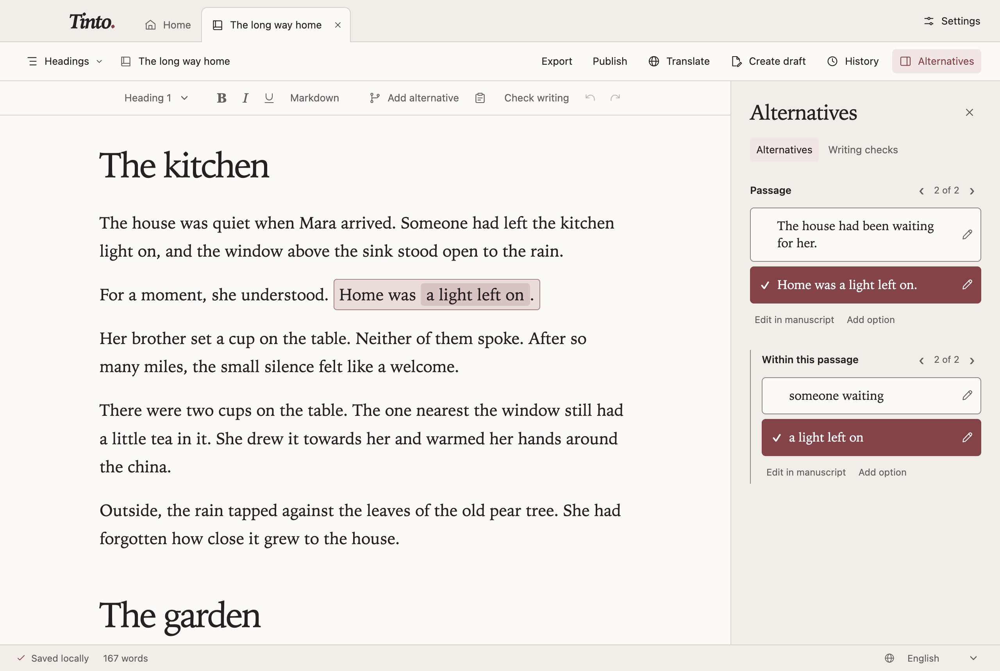
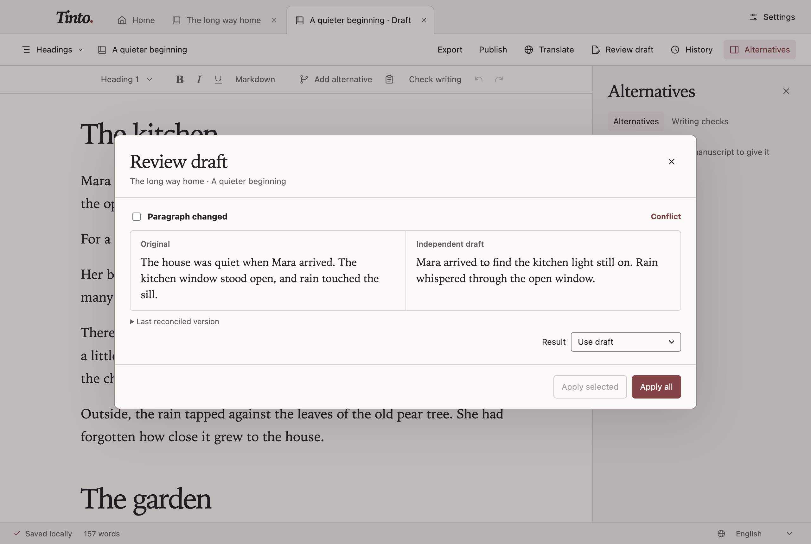
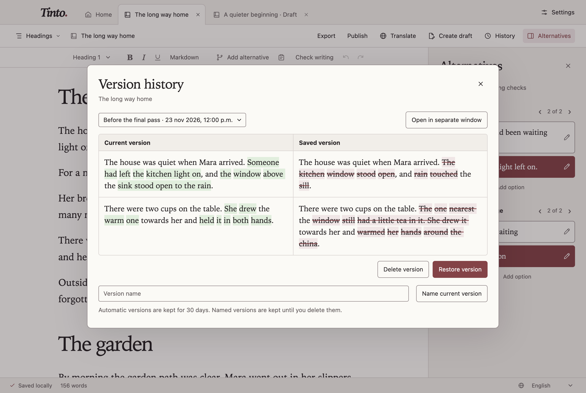
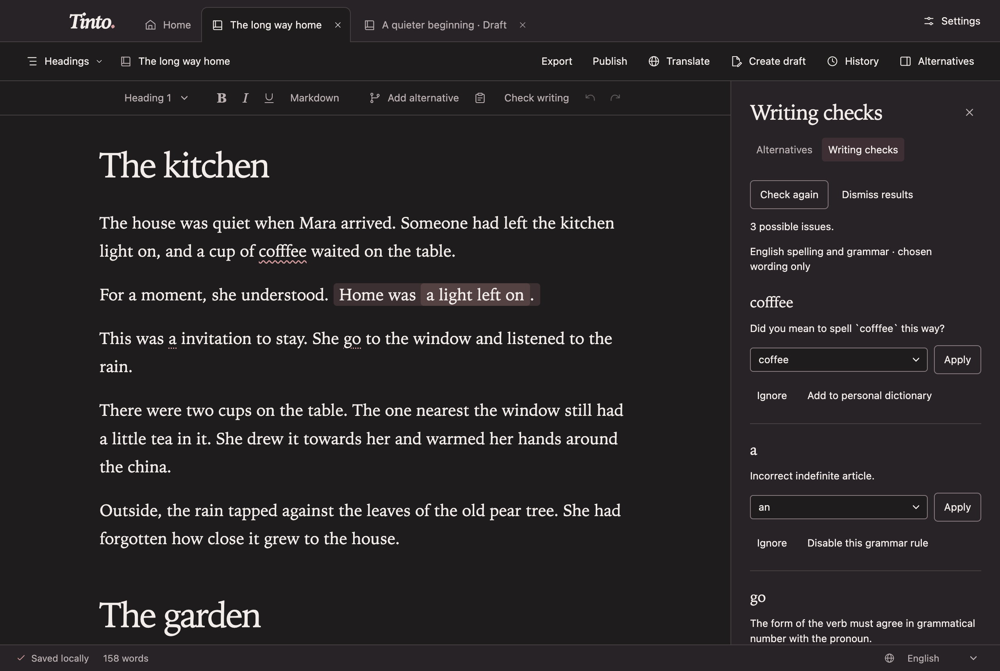
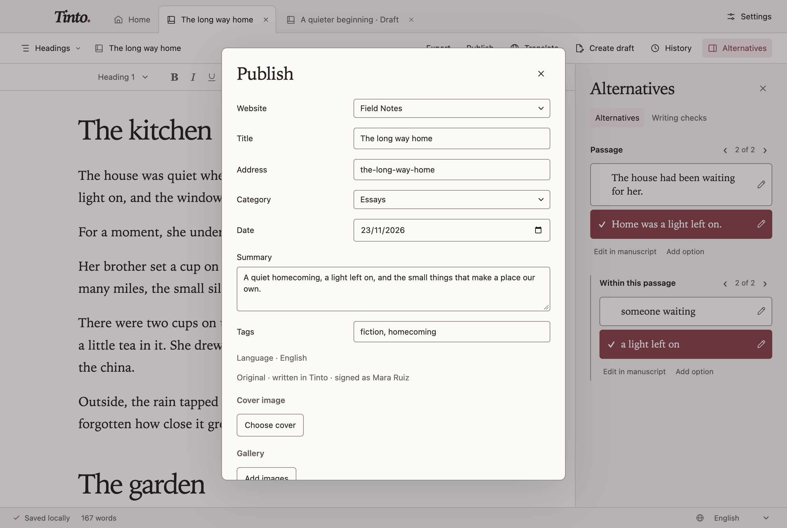
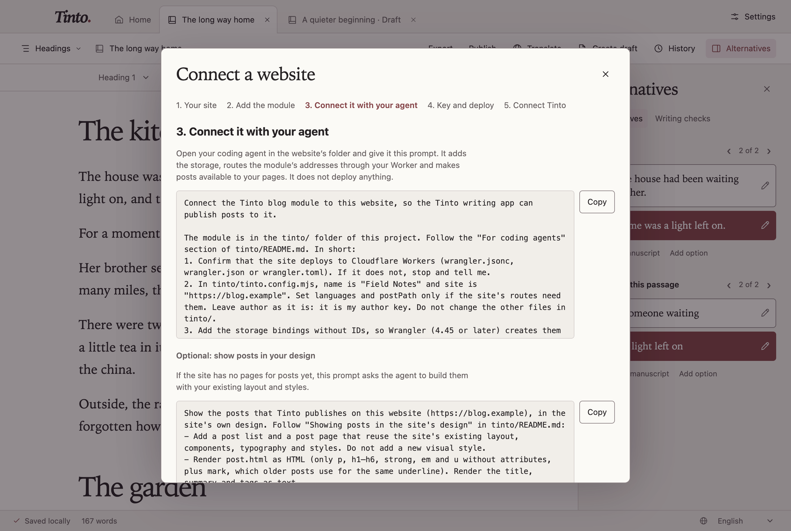

# Tinto

A local manuscript editor for macOS. Each project is a portable SQLite file with the extension `.tinto`. It contains the manuscripts, hidden wordings, draft comparison baselines, document languages, and version history.

These screenshots show Tinto 1.1 with fictional manuscripts, an example author, and a simulated website.

Version 1.1 targets macOS on Apple silicon. Linux distribution is deferred until validation on actual Linux computers; see the [release checklist and Linux validation plan](docs/v1.1-release.md).

Try another wording without losing the first. Alternatives can contain their own alternatives.

## Download

Tinto 1.1.2 is available for **macOS on Apple silicon** on the [Releases](../../releases/latest) page, as `Tinto-1.1.2-mac-arm64.dmg`.

1. Open the DMG and drag **Tinto** to **Applications**. If you already have Tinto, quit it first and choose **Replace**: your manuscripts, settings and keys are kept, because they are stored apart from the app.
2. Open Tinto. This release is not yet notarized by Apple, so the first time macOS says it cannot verify the app. Open **System Settings → Privacy & Security** and choose **Open Anyway** next to Tinto. macOS asks only once.
3. To check the download, compare the output of `shasum -a 256 Tinto-1.1.2-mac-arm64.dmg` with `SHA256SUMS.txt` from the same release.

**New versions.** When Tinto opens, and then once a day while it stays open, it asks GitHub for the latest release and, when there is a newer one, says so with a **Download** button that opens its release page. Each new version is announced once. It sends nothing from your projects and does not replace itself: install the new version from its DMG as above. Turn the check off in **Settings → About**.

## Try a wording

On first launch, choose an existing Tinto folder or create one. To try the editor in an empty folder, click **Open sample project**. This creates **The long way home** in that folder and opens its alternatives panel. Switch to “I want to eat a cat.” and back. Under **Within this passage**, choose “ice cream” or “cake”. **Edit in manuscript** selects the active text in the manuscript. Type to replace it and use the ordinary Undo shortcut to bring it back.

Select text in one paragraph and click **Add alternative** to start a new group. **Add option** makes another copy in the same group. Select text around a whole group to nest it. Use **Option+Right** on macOS or **Alt+Right** on Linux to leave an alternative before starting a new paragraph.

Erase an option’s wording to leave an empty highlighted box. Keep it empty to try the passage without those words, or click inside and type a replacement. Press Backspace or Delete again inside the empty box to remove the whole group. In the Alternatives sidebar, click the pencil to edit any option in place, or right-click a wording to delete it. When only one option remains, its wording stays in the manuscript as ordinary text.

## Writing and projects

- A rose tint marks text with alternatives. The tint deepens where alternatives are nested. To underline your own text, click **Underline** or press **⌘U** on macOS or **Ctrl+U** on Linux. Existing highlights appear as underlines.
- **Settings** in the title bar has six sections, chosen from the list on the left: **Appearance** (theme, light or dark, manuscript font, font size, line spacing, and which tools the toolbars show), **Writing** (text width, line numbers, Markdown imports, writing checks and personal dictionary, and the AI service for translation and the writing coach), **Project** (its file, version history and Google Drive backup), **Author**, **Websites** and **About** (the version, and whether Tinto checks for a new one when it opens and once a day). Settings reopens at the section you used last. A **theme** is a paper and its ink, in light and dark: Tinto, Sepia, Newsprint, Fountain pen, or High contrast. **Appearance** chooses System, Light or Dark. For the **manuscript font**, choose a font on this computer, or **Add font…** to add TTF, OTF, WOFF or WOFF2 files of one family. Tinto checks every character in the project before adding a font, names any it cannot draw, and checks again when a project opens. Characters a font cannot draw appear in a fallback font. **Text width** starts as a centered column of 680px, about 66 characters; in a narrower window the column narrows to fit. **Fixed Margin** keeps a set margin on each side instead. The footer language selector belongs to the current document.
- **Settings → Appearance → Toolbar** chooses which tools the document bar (Export, Publish, Translate, drafts, History, Alternatives) and the formatting bar (paragraph style, bold, italic, underline, Markdown, Add alternative, pasted and imported text, Check writing, undo and redo) show. All start shown. Hidden tools keep their keyboard shortcuts.
- Under **Text width**, **Fixed Margin** starts with 48 px on each side and lets the column resize with the window. **Fixed Width** centers a column of your chosen width (initially 680 px). Tinto remembers both measurements when you switch modes.
- **Home** creates and opens projects, adds documents, and imports files. Home lists the projects in your selected folder. Use **Choose folder** to browse, **New folder** to create another folder, or the **Tinto folder** menu to return to a previous one. New projects default to the selected folder. Settings shows the current project file path.
- **Headings** lets you jump to a heading in the open document or section. Click the **+** beside a heading in this dropdown, or hover over the heading in the manuscript and click **+**, to open it as a linked section (a spawn). Edits in either tab update the same text. On Home, expand a document to see its spawns. Each spawn appears under its closest spawned ancestor.
- **Settings → Writing → Show line numbers** numbers each heading and paragraph in the manuscript and in both History columns. Each version uses its own numbering. The setting starts off.
- **Markdown** beside Underline switches the current document between source and formatted editing. Headings keep their formatted appearance until you place the cursor inside one to edit its Markdown. Use `#` through `######` for headings, `**bold**`, `*italic*`, and `<u>underline</u>`. Settings can automatically open imported Markdown in source mode. Tinto remembers the mode per document. Editing a paragraph in the formatted view regenerates its Markdown from the formatting Tinto supports.
- **Import file** and **Export** support Word (.docx), PDF, plain text (.txt), Markdown (.md), HTML, rich text (.rtf), OpenDocument text (.odt), and EPUB. Conversion runs locally. Import reads selectable PDF text and text-based, DRM-free ebooks. Imported text is marked as imported (see *Authorship* below). Export writes the chosen wording of the open document, section, or draft, in the manuscript font. A font you added travels inside PDF, Word, EPUB and HTML files when its license allows it; ODT and RTF files, and fonts whose license forbids it, only name the font, and Tinto says so. Plain text drops formatting. Markdown uses inline HTML for underlines.
- English and UK English spelling and grammar, plus Spanish (Mexico) spelling, ship with the app. Choose the document language in the bottom bar; no dictionary downloads are needed.

## Compare drafts

**Create draft** copies the current document or linked section. **Review draft** compares each changed paragraph. Applying a choice updates both copies and their common baseline. A conflict needs an explicit decision.

Choose the result for each changed paragraph before applying it.

## Revisit earlier versions

**History** compares the current manuscript on the left with a saved version on the right. It opens on the latest saved version, shows only changed passages, and highlights edited words. Choose **Open in separate window** for a larger comparison. You can also name, restore, and delete versions. Tinto autosaves after 450 ms of idle typing and flushes on close. Changed work gets an automatic version after five minutes. Automatic versions stay for 30 days. Named versions stay until deleted.

Compare the current manuscript with a named version and see exactly what changed.

## Writing checks

**Check spelling while typing**, **Check English grammar while typing** and **Include style hints** start off. Enable each independently in **Settings → Writing**; changes apply to every open document and are remembered on this computer. Grammar covers agreement, verb forms, articles, capitalization, punctuation, repeated words, word choice and usage (“should of”, “taller then”, “will effect”), word order, misheard idioms (“for all intensive purposes”), words written together or apart (“alot”), and stray spaces. **Style hints** add wordiness and long sentences to English grammar checks.

Choose **Check writing** in the document toolbar to check the open document or linked section, even with both switches off. Only chosen alternatives are checked. Results appear in the **Writing checks** sidebar with the passage, explanation and proposed corrections. **Apply** accepts one correction; **Ignore** hides that suggestion while the passage is unchanged in this session. Right-click an underlined passage or press **Shift+F10** for the same actions. Every correction can be undone individually.

Review local spelling and grammar suggestions, then apply or ignore them individually.

Manual results stay until **Dismiss results**, a language change, or closing the document. Editing clears results for the changed paragraph; unchanged paragraphs keep theirs. **Check again** refreshes the current scope without turning on live checks. The **Alternatives** sidebar tab returns to wording choices.

**Add to personal dictionary** remembers a spelling across projects on this computer. English and UK English share accepted words; Spanish (Mexico) has its own list. Settings lets you add and remove words and restore grammar rules you disabled from suggestions.

Checks run locally using the official Harper.js 3.2.0 package for English and nspell with the Spanish (Mexico) dictionary. The full Harper engine is bundled, runs in a dedicated worker, and needs no network connection. Live checks wait for 500 ms of idle typing and check changed paragraphs. House-style rules, such as the Oxford comma, spelled-out numbers or avoiding contractions, are never raised. If the engine is unavailable, continue editing and saving, then use **Try again**.

Corrections preserve formatting, Markdown delimiters and pasted, imported or AI text origins. Suggestions crossing alternative structure or mixed origins explain the issue but require a manual edit. Accepted corrections do not count as typing or AI generation; they use existing undo and version history without changing the project format or signed authorship fields.

### Writing coach

The **Writing coach (AI)**, marked with sparkles, is an advanced check under **Advanced** in the Writing checks sidebar and in **Settings → Writing**. It starts off. It works like a coach rather than an editor: it points out problems with grammar, punctuation, sentence structure and wording that is confusing, ambiguous or needlessly long, explains why, and suggests how to improve each passage, sometimes with an example. It never changes your text: there is no **Apply**; you edit each passage yourself, then choose **Mark as solved**, or **Dismiss** to keep your wording.

The coach works in English, English (UK) and Spanish (Mexico), following each one's spelling and punctuation, and explains in the document's language. It uses the service, key and model of **Settings → Writing → AI service** (see *Translate*), and sends the chosen wording of the open document or linked section only when you press **Check writing** with the coach on — never while you type — up to about 10,000 words at a time. Its switch and notes appear in the sidebar below the local results, with a dashed underline in the manuscript; right-click one or press **Shift+F10** to read it there. Notes stay while you edit: each follows its passage, is labeled **Edited** once you change it, and stays until **Check again**, **Mark as solved** or **Dismiss**. The next review checks the passages you marked solved, and raises one again, labeled **Still there**, if the problem remains; it does not suggest again what you dismissed. Notes and the solved and dismissed list are kept on this computer for each document, across Markdown, closing the document and restarting Tinto, but not in the project file. Because the coach never inserts text, your authorship record is unchanged; wording you copy from a suggestion is marked as pasted, like any paste.

## Translate

**Translate** in the document bar turns a document into a new document in another language, with your own API key from **OpenAI**, **Anthropic (Claude)** or **OpenRouter**. Choose the service, the key and the model once in **Settings → Writing → AI service**, which the writing coach also uses; Tinto checks the key with the service and keeps it encrypted on this computer. Each service offers a few models (OpenAI: GPT-6.2 Astra, Sol, GPT-6.1 Terra and GPT-6 Luna; Claude: Opus 5.5 and Sonnet 5.5; OpenRouter: all six), or **Other…** for any model id. Translation is tested with OpenAI `gpt-6.2-astra`, the default; other services and models may work, so review each translation before you publish it.

- **AI service** also estimates what Translate and the writing coach have cost since you started or last reset, as a bar split between the two, from the tokens each service reports and its published prices (OpenRouter's reported cost when it gives one). Your provider's bill is exact; **Reset** starts the total again.
- Tinto sends only the chosen wording of the document you translate, paragraph by paragraph with its bold, italic and underline, and asks for a strict JSON schema so no paragraph is lost or merged. OpenAI and OpenRouter are asked not to store it; OpenRouter routes only to providers that keep the schema. Long documents go in parts of about 3,000 words. Translations into Spanish are written in Mexican Spanish.
- The translation opens as its own document, titled in its language. A note above its text says it is an automatic translation, from which language and with which model, with **Open original** and **Translate again**. Its words keep a quiet tint until you change them; words you type become yours.
- **Translate again** replaces the translation's text and keeps the previous one in History.
- **Publish** offers to publish a document and its translation together, at the same address, so the website links them as translations of each other. The second language's title and summary can be edited (**Translate summary** fills it in), and its tags, image descriptions and attachment titles are translated when you publish.
- The translation's signed credential names the original (`translationOfWork`), the model (`translator`) and how many characters were generated. Websites label it, for example *Traducción automática del inglés · revisada por Ana* once you have changed any of its words.

## Experimental: Google Drive backup

Google Drive backup is hidden in Tinto 1.0, because it has not yet been tried with a real Google account. To try it, start Tinto with `TINTO_EXPERIMENTAL=1`: `TINTO_EXPERIMENTAL=1 /Applications/Tinto.app/Contents/MacOS/Tinto` for the installed app, or `TINTO_EXPERIMENTAL=1 npm start` from the source.

Enable the Google Drive API for a Google Cloud project and create a desktop OAuth client. In **Settings → Project**, choose **Connect Google Drive**, select the downloaded client JSON, and authorize Tinto in your system browser. Tinto requests the `drive.file` scope. Store the client file outside manuscript projects. [Google desktop OAuth setup](https://developers.google.com/identity/protocols/oauth2/native-app)

Automatic backups are opt-in per local project. While Tinto is open it checks for changes every 15 minutes. **Back up now** takes an immediate snapshot. The **Tinto Backups** folder holds the five most recent completed backups per project. **Restore backup** downloads and verifies a whole project into a new local file. Use the same OAuth client on another computer to access the app’s backups. Tokens use Electron safeStorage with the operating system credential service. Linux backup connection requires a supported keyring.

## Publish to websites

**Publish** sends the open document or linked section to any website that includes the Tinto blog module. One Tinto can publish to several websites. [docs/site-contract.md](docs/site-contract.md) describes the API a website implements to receive posts. Sites on Cloudflare Workers can copy the ready-made module in [modules/cloudflare](modules/cloudflare/README.md), which adds the API, a feed for the site build, and the post files.

Prepare the post and review its authorship before publishing.

To connect a website for the first time, choose **?** next to *Add a website* in **Settings → Websites**. The guide writes the blog module into a site on Cloudflare Workers, gives your coding agent ready-made prompts, creates the API key, and lists the manual steps up to the connection. Saving the module again to the same site updates its code and keeps the site's configuration.

The guide supplies prompts for a coding agent that can edit and test your website.

You can also add a website directly in **Settings → Websites** with the two values the website gives you: its **Publishing URL** and **API key**. Tinto checks both before saving them. **Test** checks them again. **Remove** deletes the key from this computer, and the posts stay on the website. To change a key, add the same publishing URL again with the new key. Posts already published there stay linked.

In the **Publish** dialog, choose the website, then fill in the post:
- the title, address, date, summary and tags;
- the category, when the website offers categories, which it uses for its sections or pages;
- a cover, a gallery, and attachments: PDF documents, MP3, M4A and OGG audio, MP4 and WebM video, and ZIP and CSV downloads.

Each attachment has a title that the website shows. Tinto checks every file by its first bytes and uploads new files three at a time before it sends the post.

- **Publish** makes the post public.
- **Save draft** sends the post and its files to the website without showing them on its pages. A published post can go back to drafts in the same way.
- **Update post** sends changes.
- **Preview** shows the post in the website's own design before you publish it. Tinto uploads the post's files and the text as a preview, beside anything already published, then opens a private link in your browser that works for one hour. The website needs a preview page, which the guide's design prompt asks your agent to create.
- **Unpublish** removes the post and its files from the chosen website only.

The same document can be published on several websites. Each website keeps its own address, category and files. A second website starts from the text of the first, and its files are chosen again. **All posts** lists every post of the project, grouped by website and category, and marks each one as a draft, live, or changed since its release.

**Releases.** Each time a post is published with new text, Tinto saves a named version of the document in **History**, called *Released on <site>*. The website keeps that text until you publish again. While you keep editing, Publish and All posts show *Changed since the release*. Tinto does not use Git: every version, draft and release lives inside the `.tinto` project file.

The publishing URLs and keys are encrypted with the operating system's credential service, in the same way as Drive tokens. Each project file stores its posts for each website, so the address, files, status and release survive a restart. A post is recorded only after the website accepts it. After a failure, send it again. Opening a project with this version upgrades its file, and older Tinto builds cannot open the upgraded file.

## Authorship

Tinto records who wrote each post and how, and signs it.

- **Your author key.** **Settings → Author** creates a key on this computer under your name. The first time you publish, Tinto asks for the name and creates the key. The private key is encrypted with the operating system's credential service. **Export key** saves it in a file locked with a passphrase of at least 12 characters, and **Import key** uses it on another computer. Your key is a `did:key`, shown with a **Copy** button.
- **Where the words came from.** Text you type in Tinto is yours. Text pasted or dropped from another app is marked as pasted, and imported files as imported. Copying within Tinto keeps the mark, and anything you type inside a pasted passage is yours. **Show pasted and imported text** in the toolbar tints those words quietly. The marks stay in Tinto: exports and posts leave them out.
- **How it was written.** While you type, Tinto counts characters typed and deleted, active time, and the pauses between keys, by band. It never keeps the text or which keys you pressed. These counts, the amount pasted and imported, and a hash of every version and release go into a record in the project file. Each entry includes the hash of the one before it, so changing any entry shows.
- **The signature.** Every post and preview carries a W3C Verifiable Credential signed with your key. It hashes the text, each paragraph and each file, and says how much of each paragraph was written in Tinto, pasted, imported or generated by AI. It also summarizes the writing record and points to the credential of the previous release. The Publish dialog shows the summary, such as *Original · written in Tinto · signed as Ana*.
- **Websites.** A website with the current Tinto blog module accepts posts from one author: you, once it has your key. Its pages can show a quiet line such as *Original · written by Ana*. Anyone can check the signature at `<publishing URL>/credentials/<post>`. Tinto tells you when a website's module does not check authorship yet.
- **What it proves.** The record shows that the text was typed in Tinto, by the holder of the key, and that the post was not changed afterwards. It does not show that the ideas are original. AI-generated text, when Tinto offers it, will always be labeled as AI.

## Build it yourself

- **macOS on Apple silicon** — `npm run package -- darwin arm64`, then open `out/Tinto-darwin-arm64/Tinto.app`. Run `npm run dmg` to create `out/release/1.1.0/Tinto-1.1.0-mac-arm64.dmg`, its checksums, and the corresponding Pandoc source archive. This local build uses an ad-hoc signature and is not notarized.
- **Ubuntu or Debian (unverified local builds)** — Build the `.deb` as described in *Build and check*. Choose `amd64` for Intel or AMD processors and `arm64` for ARM processors. Install with `sudo apt install ./out/tinto_1.1.0_amd64.deb` or the corresponding ARM64 filename, then launch **Tinto** from the applications menu. The [native Linux release checks](docs/v1.1-release.md#linux-validation-deferred-to-actual-linux) are still pending; no Linux installer is included in this release.
- **From source** — With Node.js 24.13 or later and npm, run `npm ci` and `npm start`. The first run downloads Electron. Subsequent writing sessions work offline.

## Build and check

- `npm run typecheck` checks the TypeScript.
- `npm run screenshots` rebuilds and captures the six README views in a disposable profile. It uses fictional content and simulated services, with no live publishing or API requests. Screenshots are saved in `docs/screenshots/`.
- `npm test` runs the editor, desktop, storage, drafts, file exchange, backup and publishing checks. Browser tests use system Chrome on macOS. On Linux install Playwright Chromium with `npx playwright install chromium` or set `CHROME_PATH` to an existing Chromium executable. Desktop tests need a graphical session or Xvfb.
- `npm run package` builds the app for the current machine. Use `npm run package -- linux x64` or `npm run package -- linux arm64` for a Linux folder. On Linux, run `sh scripts/linux-deb.sh amd64` or `sh scripts/linux-deb.sh arm64` to generate its installer. Prerelease packages go into `out/development`; release packages use `out`.
- `npm run dmg` packages the already-built macOS Apple silicon app. It checks the version, architecture, signature, disk-image integrity, and Pandoc source checksum. Each installer is kept under `out/release/<version>/` and an existing installer is never overwritten. The v1.0.0 tag and installer remain intact; v1.1.0 has not been published.

## License

Original Tinto code is released under the MIT license. Tinto includes Harper.js 3.2.0 under Apache-2.0 and pandoc 3.10 for converting Markdown, RTF, ODT and EPUB files; pandoc is released under the GNU GPL, version 2 or later. See [NOTICE.md](NOTICE.md) for third-party software and where to find pandoc's source. Packaged applications include dependency licenses and the notices supplied with each dictionary.

## Verification record

- **1.1.2 installer, macOS Apple silicon.** All 40 checks across the desktop suites passed against the mounted installer, and the upgrade regression passed from the v1.0.0, v1.1.0 and v1.1.1 installers. The source suite passed 120 of 120. See [the v1.1.2 record](docs/v1.1.2-release.md).
- **1.1.1 installer, macOS Apple silicon.** All 38 checks across the desktop suites passed against the mounted installer, and the upgrade regression passed from both the v1.0.0 and the v1.1.0 installers. The source suite passed 115 of 115. The writing coach was checked against OpenAI `gpt-6.2-astra` in English, English (UK) and Spanish (Mexico): every note quoted its passage exactly. See [the v1.1.1 record](docs/v1.1.1-release.md).
- **1.1.0 installer, macOS Apple silicon.** All 37 checks across the desktop suites and the v1.0.0 upgrade regression passed against the mounted installer, with no failures or skips. Projects, alternatives, drafts, history, authorship records, and preferences survived the upgrade. Harper checked approximately 80,000 words offline in 4.34 seconds with a maximum renderer scheduling gap of 30 ms. The disk image, signature, bundled assets, and checksums passed verification. It was published on 2026-11-23 as the v1.1.0 release.
- **1.1 development, macOS Apple silicon.** Type checking and all 107 tests passed, with no skipped tests. Five additional packaged-app writing checks passed; approximately 80,000 words were checked offline in 4.36 seconds with a maximum renderer scheduling gap of 32 ms. The control-stability sweep covers retained replacement selections and focus, repeated requests, late results, failed preference saves, dictionary/rule restoration, and keyboard pagination, alongside the existing language, Unicode, formatting, attribution, and undo checks. Light/dark, narrow-window, and 200% zoom checks passed; the focused Impeccable reassessment scored 18/20. Earlier current-file and reachable-history secret scans found no candidate credentials. The v1.0 installer and source archive still match their release checksums. Linux remains deferred to native-device validation. See the [complete release evidence and remaining Linux checklist](docs/v1.1-release.md).
- **macOS, Apple silicon.** The full 30-test suite passed, including first-open folder selection, folder creation, and switching folders across restarts. The packaged editor passed the nested-choice edit, undo, save, close, and reopen sequence. Desktop checks also covered English and Spanish spelling, linked-section renaming and scroll, reading settings, version restoration, partial draft reconciliation, and local file exchange. Pages and Preview opened the exported files. The Underline tool was also checked in the installed app, in the exported PDF, and after a DOCX round trip.
- **Ubuntu 24.04.** The ARM64 and amd64 installers were installed in separate offline Docker environments. Seven installed-app checks on each architecture covered choosing and creating folders, nested editing and reopening, bilingual spelling, draft review, local file exchange, tab navigation, keyboard focus, reading preferences, and saving to the correct file after a restore. ARM64 ran natively in the Linux VM. The amd64 run used emulation. The automated Chromium launcher required its test sandbox setting in Docker. A regular graphical Linux desktop launch with the distribution's sandbox and keyring still needs a device check.
- **Drive.** A loopback authorization test exercised state, PKCE, token refresh, and disconnect against a simulated Google endpoint. Backup tests restored a complete SQLite project, including pending draft conflicts and hidden wording, and kept five previous backups after a failed upload. A live Google-account backup and restore still requires personal authorization.
